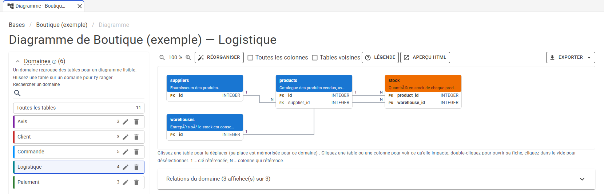

# GranitDb

**Le catalogue de métadonnées de vos bases de données** : décrivez bases, tables, colonnes et relations, gardez la documentation vivante, partagez-la.



*Diagramme entité-relation du domaine « Logistique » d'une base d'exemple : tables du domaine, clés primaires et étrangères, cardinalités.*

## Pourquoi GranitDb

- **Aucun serveur requis** : le catalogue est un fichier SQLite, et une base à documenter peut être un simple fichier SQLite. SQL Server, PostgreSQL et MySQL / MariaDB sont aussi pris en charge comme sources.
- **Schéma lu, jamais modifié** : tables, colonnes, clés, index et relations sont extraits en lecture seule ; les descriptions saisies à la main survivent aux resynchronisations (aperçu des différences avant application, synchronisation planifiée possible).
- **Documentation collaborative** : descriptions modifiables en place, étiquettes, colonnes sensibles, historique, complétude, analyse d'impact.
- **Diagrammes par domaine** : regroupez les tables par sujet, placez-les, exportez en SVG, PNG ou Mermaid.
- **Exports** : documentation HTML autonome, Markdown, CSV, Excel, PDF.
- **Aides à la documentation** : détection assistée des relations manquantes, profilage léger des colonnes, propositions de descriptions par un modèle local (optionnel, jamais de valeur de ligne envoyée).
- **Prêt à partager** : API REST (Swagger), interface Blazor, authentification GitHub / OpenID Connect avec rôles, bases publiques en lecture, webhooks, journal d'audit, Docker.

## Démarrage en deux minutes

Avec Docker :

```bash
docker compose up --build   # interface http://localhost:8081, API http://localhost:5105/swagger
```

Sans Docker ([.NET 10 SDK](https://dotnet.microsoft.com/download/dotnet/10.0)) :

```bash
dotnet run --project api --launch-profile http   # API sur http://localhost:5105 (Swagger : /swagger)
dotnet run --project client                      # interface sur http://localhost:5028
```

Ouvrez l'interface et glissez un fichier `.db` / `.sqlite` sur la zone de dépôt : tables, colonnes, types, clés et relations sont extraits et affichés. Le fichier source est ouvert en lecture seule.

## Documentation

| Page | Contenu |
|---|---|
| [Guide utilisateur](docs/guide-utilisateur.md) | Du premier import à l'export, pas à pas |
| [L'interface](docs/interface.md) | Espace de travail, raccourcis, diagramme, recherche |
| [Sources serveur](docs/sources-serveur.md) | SQL Server, PostgreSQL, MySQL |
| [Aides à la documentation](docs/aides-documentation.md) | Profilage, relations suggérées, synchronisation planifiée, assistant d'IA |
| [Authentification et rôles](docs/authentification.md) | GitHub, OpenID Connect, bases publiques |
| [Configuration](docs/configuration.md) | Réglages de l'API |
| [Déploiement et tests](docs/deploiement.md) | Docker, sauvegarde, migrations, CI |
| [API REST](docs/api.md) | Routes, filtres, webhooks |

L'index complet est dans [`docs/`](docs/README.md). L'audit du code et la feuille de route sont dans [`work-doc/`](work-doc/), l'architecture et les conventions dans [`CLAUDE.md`](CLAUDE.md).

## Tests

```bash
dotnet test tests/GranitDb.Tests
```

Aucun service externe n'est nécessaire ; les tests des serveurs SQL sont ignorés sans Docker.

## Licence

[PolyForm Noncommercial 1.0.0](LICENSE) : utilisation, modification et redistribution libres pour tout usage non commercial (personnel, recherche, enseignement, associations, organismes publics…). Tout usage commercial demande l'accord de l'auteur.
