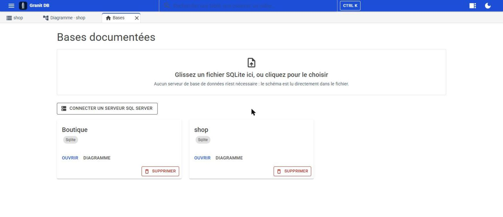
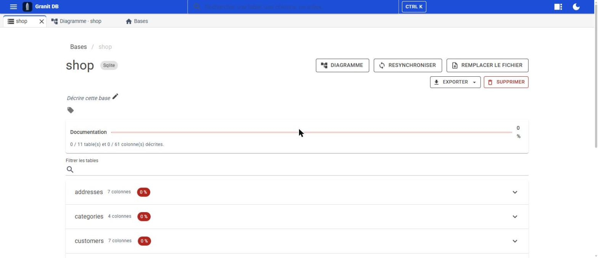
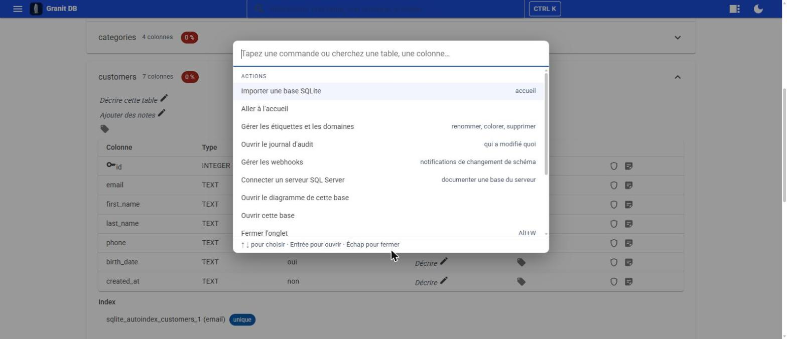
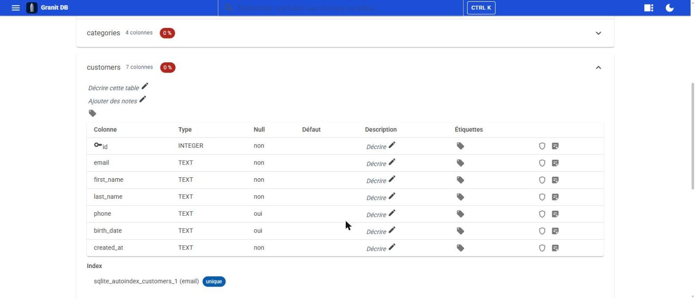
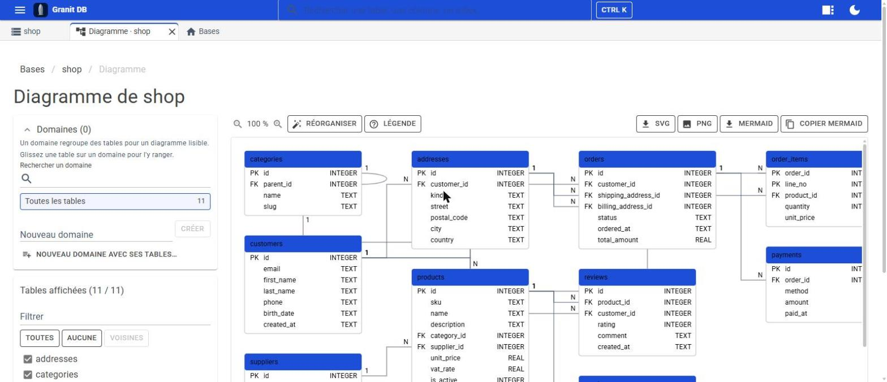
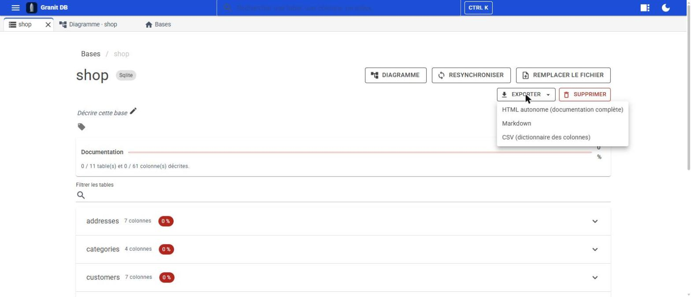

# GranitDb : guide utilisateur

GranitDb est un **catalogue de métadonnées** : il lit la structure d'une base de données (tables, colonnes, clés, index) et vous permet de la **documenter** (descriptions, notes, étiquettes, domaines, relations) puis de la **partager** (exports, diagramme). Vos données ne sont jamais lues : seul le schéma l'est, et la source n'est jamais modifiée.

Les exemples utilisent `shop.sqlite`, la base de boutique fournie à la racine du dépôt.

## 1. Démarrer

```bash
dotnet run --project api --launch-profile http   # API : http://localhost:5105
dotnet run --project client                      # interface : http://localhost:5028
```

Avec Docker : `docker compose up --build`, puis http://localhost:8081.

## 2. Ajouter une base à documenter



### Fichier SQLite
Sur l'accueil (page **Bases**), glissez un fichier `.db` / `.sqlite` sur la zone de dépôt, ou cliquez dessus pour le choisir. Donnez-lui un nom : tables, colonnes, types, clés et relations apparaissent. Le fichier est conservé par le serveur pour pouvoir être relu plus tard.

### Base SQL Server
Depuis l'accueil (ou **Ctrl+K**) : « Connecter un serveur SQL Server ».
1. Saisissez serveur, port, base, authentification (identifiant SQL ou compte Windows du processus de l'API) et chiffrement.
2. **Tester la connexion** : le message indique précisément ce qui échoue (identifiants, base absente, serveur injoignable, certificat, droits).
3. Choisissez les schémas à documenter, puis **Importer**.

Un compte avec le seul droit `VIEW DEFINITION` suffit. La connexion est enregistrée chiffrée et n'est jamais réaffichée. Si l'administrateur a désactivé cette fonction, l'entrée n'apparaît pas.

## 3. S'orienter dans l'interface



- **Explorateur** (colonne de gauche) : arbre bases → tables → colonnes, avec les domaines et vos favoris. Navigation au clavier avec les flèches.
- **Onglets** : chaque page ouverte a son onglet ; un clic du milieu ferme/ouvre sans changer de page. L'espace de travail (onglets, favoris) est mémorisé dans le navigateur.
- **Panneau de détail** : affiche l'élément sélectionné dans l'explorateur.
- **Recherche globale** (barre du haut, Entrée) : cherche dans les noms et descriptions de tout le catalogue, résultats groupés par type.
- **Palette de commandes** : **Ctrl+K** pour aller n'importe où.


- **Thème** clair/sombre : bouton dans la barre du haut (suit le système par défaut).

## 4. Documenter

Les textes se modifient **sur place** : cliquez dans une description, tapez, puis **Entrée** (ou quittez le champ) pour enregistrer, **Échap** pour annuler. Un message avec « Annuler » permet de revenir en arrière.



Sur chaque base, table et colonne :
- **Description** : à quoi sert l'élément (ex. `orders.status` : « état de la commande : pending, paid, shipped… »).
- **Notes** : informations complémentaires (règles de gestion, source, contact).
- **Colonne sensible** : marquez les colonnes contenant des données personnelles (ex. `customers.email`, `birth_date`). Elles sont comptées à part dans la complétude tant qu'elles ne sont pas décrites.
- **Étiquettes** : ajoutez des tags colorés (base, table ou colonne) pour classer (« RGPD », « finance »…).

Chaque changement de description, de notes ou de marquage sensible est **historisé** (qui, quand, avant/après).

### Complétude
Sur la page d'une base, la complétude indique la part des tables et colonnes décrites (une description vide ne compte pas). Elle se filtre par domaine : repérez ce qu'il reste à documenter.

## 5. Les relations

Les clés étrangères sont détectées à l'import et marquées comme **relations automatiques** : elles sont recréées à chaque synchronisation et ne se suppriment pas (leur description et leur type se corrigent).

Pour une relation que la base ne déclare pas (souvent le cas en production), **Ajouter une relation** : choisissez les colonnes de chaque côté et le type (1-1, 1-N, N-N). L'outil refuse une colonne inexistante, deux bases différentes ou un doublon. Les relations manuelles ne sont jamais touchées par une synchronisation. Les clés composites forment une seule relation à plusieurs paires de colonnes.

### Analyse d'impact
Sélectionnez une table ou une colonne : l'**impact** liste ce qui en dépend (qui la référence, en chaîne) et ce dont elle dépend. Utile avant de modifier un champ.

## 6. Domaines et diagramme

Un **domaine** regroupe des tables d'un même sujet (ex. « Ventes » : `orders`, `order_items`, `payments` ; « Catalogue » : `products`, `categories`, `suppliers`).

- **Nouveau domaine** : depuis la page Diagramme ou « Nouveau domaine avec ses tables… ». Choisissez nom et couleur.
- Rangez une table dans un domaine par glisser-déposer : depuis la liste des tables, ou directement depuis le diagramme vers la carte du domaine.
- **Étiquettes et domaines** (menu) : renommer, recolorer, supprimer.

### Page Diagramme (`/databases/{id}/diagram`)



- Vue d'ensemble ou vue d'un domaine ; les cases du sélecteur de tables disent quelles tables sont affichées (dans un domaine : l'appartenance).
- **Voisines** / option « voisines » du domaine : montre en pointillé les tables d'autres domaines liées au domaine (nœuds « frontière »).
- Glissez les tables pour les réorganiser (**Réorganiser** remet l'automatique) : la disposition est mémorisée par domaine. Zoom à la molette ou aux boutons.
- Cliquez une table pour voir son impact ; **Ouvrir la table** y accède.
- Les relations peuvent être masquées pour un domaine (« Tout masquer » / « Tout afficher » / « Légende »).
- **Export** : SVG, PNG, ou code **Mermaid** (« Copier Mermaid »).

## 7. Garder le catalogue à jour

Quand la source change :
- **Resynchroniser** (page de la base) : relit la source. Un **aperçu** montre d'abord ce qui serait ajouté, modifié ou supprimé, et **signale ce qui ferait perdre une documentation** (colonne supprimée ayant une description…). Vous appliquez ensuite.
- Les descriptions écrites à la main sont **conservées** ; seuls les éléments disparus de la source sont supprimés.
- **Remplacer le fichier** : importez une nouvelle version d'un fichier SQLite ; un aperçu des différences est proposé sans rien écrire.
- **Modifier la connexion** (SQL Server) : change le mot de passe ou les schémas.
- Une base lue uniquement via la configuration du serveur ne peut pas être resynchronisée depuis l'interface.

## 8. Exporter et partager



Bouton **Exporter** sur la page d'une base :
| Format | Usage |
|---|---|
| **HTML autonome** | Un seul fichier prêt à envoyer : arbre navigable par domaine/table, colonnes, relations, index, diagrammes (un par domaine et un par table). |
| **Markdown** | Documentation texte pour un wiki ou un dépôt. |
| **CSV** | Dictionnaire des colonnes pour Excel. |

## 9. Importer une documentation existante

Via l'API (`POST /api/v1/import/documentation/{databaseId}`) vous pouvez remplir les descriptions **vides**, les domaines (avec leur disposition) et les relations manuelles à partir d'une documentation externe (rapprochement par nom ; rien d'existant n'est écrasé). Un convertisseur pour un export Dataedo est fourni dans `work-doc/herakles-tools/`.

## 10. Administration

- **Journal d'audit** (menu) : qui a modifié ou exporté quoi, quand, avec quel résultat ; filtres par acteur, méthode, statut, dates. Le contenu des requêtes n'est jamais enregistré. Conservation 365 jours par défaut.
- **Webhooks** (menu) : une URL appelée quand le schéma change après une synchronisation (`schema.changed`), ou quand une base est importée/supprimée. **Ajouter un webhook**, **Tester**, consulter les **Envois** (statut, tentatives). Un secret optionnel signe chaque appel (`X-GranitDb-Signature`). Les adresses locales ou privées sont refusées sauf réglage serveur.
- **Supprimer une base** : retire la base du catalogue (pas la source) ; pour confirmer il faut retaper son nom. Opération définitive, tracée dans l'historique.

La configuration du serveur (fournisseur du catalogue, taille maximale d'import, sources au démarrage…) est décrite dans le [README](../README.md).

## 11. Pas à pas avec `shop.sqlite`

1. Sur la page Bases, cliquez « Essayer avec un exemple » (ou déposez `shop.sqlite` vous-même) : la base « Boutique (exemple) » est importée.
2. Ouvrez la table `customers`, décrivez-la, marquez `email`, `phone`, `birth_date` comme sensibles.
3. Créez les domaines « Catalogue » (`categories`, `suppliers`, `products`, `stock`, `warehouses`), « Clients » (`customers`, `addresses`) et « Ventes » (`orders`, `order_items`, `payments`, `reviews`).
4. Ouvrez le diagramme du domaine « Ventes » ; activez les voisines pour voir les tables liées.
5. Cliquez `products` : l'analyse d'impact montre que `order_items`, `stock` et `reviews` en dépendent.
6. Exportez en **HTML autonome** et ouvrez le fichier.

## Dépannage

| Symptôme | Piste |
|---|---|
| « Fichier refusé » à l'import | Ce n'est pas une base SQLite valide, ou elle dépasse la taille maximale (`MaxUploadMb`, 100 Mo). |
| SQL Server : serveur injoignable depuis Docker | Utilisez `host.docker.internal` au lieu de `localhost`, activez TCP/IP et le port dans le pare-feu. |
| « Saisissez-la de nouveau » | La connexion enregistrée n'est plus déchiffrable (clés perdues) : ressaisissez-la avec **Modifier la connexion**. |
| Données obsolètes dans l'interface | **Actualiser**, ou resynchronisez la base. |
| Webhook refusé | L'adresse est locale/privée : voir `Webhooks:AllowPrivateHosts`. |
